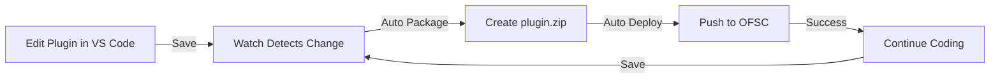

# 🚀 Efficient OFSC Plugin Development from VS Code

## Overview

This repository now includes a complete plugin development workflow that allows you to:
- ✅ Edit plugin code in VS Code
- ✅ Deploy to OFSC instance with **one keystroke**
- ✅ Auto-deploy on file changes (watch mode)
- ✅ Test with Newman/Postman CLI
- ✅ CI/CD ready

## 🎯 Three Ways to Deploy

### 1. VS Code Tasks (Fastest) ⚡

**One-Click Deploy:**
```
Press: Cmd+Shift+B (Mac) or Ctrl+Shift+B (Windows)
→ Enter plugin path
→ Done! ✅
```

### 2. Command Line

```bash
# Deploy once
npm run deploy plugins/my-plugin

# Auto-deploy on changes
npm run deploy:watch plugins/my-plugin
```

### 3. Custom Keyboard Shortcut

Set up `Cmd+Shift+D` for instant deploy:

```json
// In keybindings.json
{
    "key": "cmd+shift+d",
    "command": "workbench.action.tasks.runTask",
    "args": "OFSC: Package & Deploy Plugin"
}
```

## 📁 File Structure

```
ofsc-postman-collection/
├── 📘 README.md                    # Main documentation
├── 🚀 QUICKSTART.md                # 5-minute setup guide
├── 📖 PLUGIN_DEVELOPMENT_GUIDE.md  # Complete development guide
├── 
├── scripts/
│   ├── deploy-plugin.js            # Deploy plugin to OFSC
│   └── watch-and-deploy.js         # Auto-deploy on changes
├── 
├── .vscode/
│   └── tasks.json                  # VS Code task definitions
├── 
├── .env.example                    # Configuration template
├── package.json                    # npm scripts & dependencies
└── Oracle Field Service Cloud...   # Postman collection
```

## 🔄 Workflow Example



## 📋 Quick Commands Reference

| Action | Command | Shortcut |
|--------|---------|----------|
| **Deploy Once** | `npm run deploy plugins/my-plugin` | `Cmd+Shift+B` |
| **Watch Mode** | `npm run deploy:watch plugins/my-plugin` | - |
| **Test Plugins** | `npm run test:plugins` | - |
| **Test All** | `npm test` | - |
| **Test Report** | `npm run test:report` | - |

## 🛠️ Setup (One-Time)

### Step 1: Install Dependencies

```bash
npm install
```

This installs:
- `newman` - Postman CLI for testing
- `chokidar` - File watcher for auto-deploy
- `dotenv` - Environment configuration

### Step 2: Configure OFSC Instance

```bash
cp .env.example .env.local
```

Edit `.env.local`:
```bash
OFSC_BASE_URL=https://your-instance.ofsc.oracle.com/rest
OFSC_USERNAME=your_username@instance_id  
OFSC_PASSWORD=your_api_key
```

### Step 3: Create Your Plugin

```bash
mkdir -p plugins/my-plugin
cd plugins/my-plugin

# Create plugin.js
cat > plugin.js << 'EOF'
(function(api) {
    'use strict';
    api.log('Plugin loaded!');
})(PluginAPI);
EOF

# Package it
zip -r plugin.zip *
```

### Step 4: Deploy!

```bash
# Method 1: npm command
npm run deploy plugins/my-plugin

# Method 2: VS Code task
# Press Cmd+Shift+B

# Method 3: Watch mode
npm run deploy:watch plugins/my-plugin
```

## 💡 Development Patterns

### Pattern 1: Active Development (Watch Mode)

```bash
# Start watch mode
npm run deploy:watch plugins/my-plugin

# Now edit files in VS Code
# Changes auto-deploy after 2 seconds
# Keep coding!
```

### Pattern 2: Manual Deploy

```bash
# Make changes
code plugins/my-plugin/plugin.js

# Deploy when ready
npm run deploy plugins/my-plugin
```

### Pattern 3: VS Code Integrated

```
1. Open plugin in VS Code
2. Edit code
3. Press Cmd+Shift+B
4. Plugin auto-packages and deploys
5. Continue editing
```

## 🧪 Testing Workflow

### Test Plugin Endpoints

```bash
npm run test:plugins
```

### Test All APIs

```bash
npm test
```

### Generate HTML Report

```bash
npm run test:report
open reports/test-report.html
```

## 🔌 Plugin API Endpoints

Available in Postman collection under **Metadata → Plugins**:

1. **Import Plugins** (POST)
   - Endpoint: `/rest/ofscMetadata/v1/plugins/custom-actions/import`
   - Use: Deploy custom plugins
   
2. **Install Standard Plugin** (POST)
   - Endpoint: `/rest/ofscMetadata/v1/plugins/{pluginLabel}/custom-actions/install`
   - Use: Install Oracle standard plugins

## 📊 VS Code Tasks Available

Open Command Palette (`Cmd+Shift+P`) → "Tasks: Run Task":

- `OFSC: Deploy Plugin` - Deploy once
- `OFSC: Package Plugin` - Create plugin.zip
- `OFSC: Package & Deploy Plugin` - Package then deploy
- `OFSC: Test Collection (Newman)` - Run API tests
- `OFSC: Import Plugin` - Direct API call
- `OFSC: Install Standard Plugin` - Install by label
- `OFSC: Run All Tests` - Full test suite with report

## 🎓 Learning Path

1. **Start Here**: [QUICKSTART.md](QUICKSTART.md) - Get up and running in 5 minutes
2. **Deep Dive**: [PLUGIN_DEVELOPMENT_GUIDE.md](PLUGIN_DEVELOPMENT_GUIDE.md) - Complete guide
3. **API Reference**: [README.md](README.md) - Full API documentation
4. **Practice**: Create a simple plugin and use watch mode

## 🔐 Security Notes

- ✅ `.env.local` is gitignored (your credentials stay private)
- ✅ `.env.example` provided as template
- ✅ Plugins folder gitignored
- ✅ Never commit real credentials

## 🚀 Advanced: CI/CD Integration

The scripts are CI/CD ready:

```yaml
# .github/workflows/deploy-plugin.yml
name: Deploy Plugin
on:
  push:
    paths: ['plugins/**']

jobs:
  deploy:
    runs-on: ubuntu-latest
    steps:
      - uses: actions/checkout@v2
      - run: npm install
      - run: npm run deploy plugins/my-plugin
        env:
          OFSC_BASE_URL: ${{ secrets.OFSC_BASE_URL }}
          OFSC_USERNAME: ${{ secrets.OFSC_USERNAME }}
          OFSC_PASSWORD: ${{ secrets.OFSC_PASSWORD }}
```

## 📈 Benefits

| Before | After |
|--------|-------|
| ❌ Manual export from OFSC | ✅ Direct deploy from VS Code |
| ❌ Copy/paste code | ✅ Edit in your IDE |
| ❌ Manual testing | ✅ Automated testing with Newman |
| ❌ Slow iteration | ✅ Auto-deploy on save (2sec) |
| ❌ No version control | ✅ Git integration |

## 🆘 Troubleshooting

### "Authentication failed"
Check `.env.local` has correct credentials

### "Plugin not found"  
Run `cd plugins/my-plugin && zip -r plugin.zip *` first

### "Watch mode not working"
Install chokidar: `npm install chokidar`

### "Newman command not found"
Install globally: `npm install -g newman`

## 📚 Additional Resources

- [Oracle OFSC Plugin Guide](https://docs.oracle.com/en/cloud/saas/field-service/plugin-guide/)
- [Newman Documentation](https://learning.postman.com/docs/running-collections/using-newman-cli/)
- [VS Code Tasks](https://code.visualstudio.com/docs/editor/tasks)

---

**Ready to start?** → [QUICKSTART.md](QUICKSTART.md)

**Questions?** Open an issue on GitHub!

---

*Made with ❤️ for efficient OFSC plugin development*
